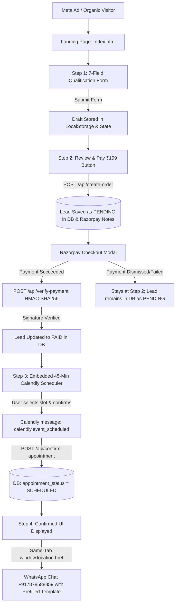

# ZR Interior Design — Project Documentation (Phase 2)

> **Document Version**: 2.1.0 (Phase 2 Funnel & Lead Architecture)  
> **Repository**: [JunedBanzara/ZR-Interior-Landing-page](https://github.com/JunedBanzara/ZR-Interior-Landing-page)  
> **Production Website**: [https://zr-interior-landing-page.vercel.app/](https://zr-interior-landing-page.vercel.app/)  
> **Studio**: ZR Interior Design, Vadodara, Gujarat (Est. 1990)  
> **Principal Designer**: Mr. Zuber Rafik Banzara  
> **WhatsApp Business**: [+91 7878588859](https://wa.me/917878588859)  
> **Active Calendly Link**: [https://calendly.com/zrinteriordesign/45min](https://calendly.com/zrinteriordesign/45min)

---

## 1. Executive Summary & Phase 2 Objectives

Phase 2 focuses on hardening the full conversion funnel, resolving scheduling friction, and ensuring zero lead leakage between customer intake and sales handoff:

1. **45-Minute Consultation Realignment**: Transitioned all booking references, calendar parameters, and API endpoints from the deprecated 30-minute link (which returned HTTP 404) to the active 45-minute booking URL (`https://calendly.com/zrinteriordesign/45min`).
2. **Calendly-to-WhatsApp Automation**: Eliminated browser popup-blocking issues by redirecting the active tab (`window.location.href`) immediately upon appointment confirmation.
3. **Pre-Payment Lead Capture**: Preserved 100% of lead submissions *before* payment occurs, preventing lost inquiries due to payment drop-offs or gateway cancellations.
4. **Verified WhatsApp Handshake**: Standardized the prefilled 7-field WhatsApp message template containing customer details, property metadata, confirmed appointment time, and verified Razorpay payment ID.
5. **Anti-Double-Payment Protection**: Retained client payment state in browser `localStorage` and backend database so page reloads or external navigation never prompt an already-paid customer to pay again.

---

## 2. Complete End-to-End Funnel Architecture

The consultation booking system follows an unbroken 5-stage sequential lifecycle:



### Stage Breakdown

| Stage | Component / File | User Experience | Backend Action |
| :--- | :--- | :--- | :--- |
| **1. Intake** | [`src/js/form.js`](file:///d:/DYNODE%20TECHNOLOGIES/Funnel%20for%20ZR/src/js/form.js) | Customer enters 7 fields: Name, Phone, Email, Location, Property Type, Budget, and Project Stage. | Stored in `localStorage` under `zr_qualification_draft`. Meta `Lead` pixel event fires. |
| **2. Order Creation** | [`api/razorpay/create-order.js`](file:///d:/DYNODE%20TECHNOLOGIES/Funnel%20for%20ZR/api/razorpay/create-order.js) | Customer reviews details and clicks *"Pay ₹199 via Razorpay"*. | Creates Razorpay order. **Saves lead record to Database with `payment_status: 'PENDING'`**. Mirrors lead in Razorpay Order `notes`. |
| **3. Payment** | [`api/razorpay/verify-payment.js`](file:///d:/DYNODE%20TECHNOLOGIES/Funnel%20for%20ZR/api/razorpay/verify-payment.js) | Razorpay official modal opens. Customer pays ₹199 via UPI, Card, or Netbanking. | Server validates HMAC-SHA256 signature using `RAZORPAY_KEY_SECRET`. Updates database to `payment_status: 'PAID'`. |
| **4. Scheduling** | [`src/js/booking.js`](file:///d:/DYNODE%20TECHNOLOGIES/Funnel%20for%20ZR/src/js/booking.js) | Step 3 displays inline Calendly widget prefilled with client name, phone, and booking ID. | Listens for `calendly.event_scheduled` postMessage (or external redirect params). Calls `/api/confirm-appointment`. |
| **5. WhatsApp Dispatch** | [`src/js/whatsapp.js`](file:///d:/DYNODE%20TECHNOLOGIES/Funnel%20for%20ZR/src/js/whatsapp.js) | Step 4 displays confirmation card and immediately redirects current tab to WhatsApp. | Navigates `window.location.href` to `https://wa.me/917878588859` with URL-encoded 7-field message. |

---

## 3. Lead Data Storage & Access Architecture

### 3.1 Where Are Leads Stored?

Customer data is captured across four separate, resilient layers:

```
┌─────────────────────────────────────────────────────────────────────────────┐
│ 1. PRIMARY PERSISTENCE LAYER: [server/db.js]                                │
│    • Supabase PostgreSQL (Table: consultation_bookings)                     │
│    • Local Fallback: [data/bookings.json] + In-Memory Serverless Cache      │
├─────────────────────────────────────────────────────────────────────────────┤
│ 2. PAYMENT GATEWAY MIRROR: Razorpay Cloud                                    │
│    • Razorpay Order `notes` (Stored on Razorpay servers at order creation)  │
├─────────────────────────────────────────────────────────────────────────────┤
│ 3. CLIENT-SIDE STORAGE: Browser LocalStorage                                │
│    • `zr_qualification_draft` (Form draft)                                  │
│    • `zr_consultation_session` (Paid status, tokens, booking references)    │
├─────────────────────────────────────────────────────────────────────────────┤
│ 4. SCHEDULER STORE: Calendly Cloud                                          │
│    • Invitee records, event UUIDs, and tracking UTMs (utm_campaign)         │
└─────────────────────────────────────────────────────────────────────────────┘
```

### 3.2 Pre-Payment vs. Post-Payment Timing

> [!IMPORTANT]
> **Leads are saved BEFORE payment occurs.**
> When a user clicks *"Pay ₹199 via Razorpay"*, [`/api/create-order`](file:///d:/DYNODE%20TECHNOLOGIES/Funnel%20for%20ZR/api/razorpay/create-order.js) executes `DB.createBooking(...)` immediately before the Razorpay modal opens.

- **Pre-Payment State**: Record created with `payment_status: "PENDING"`, `appointment_status: "UNSCHEDULED"`.
- **Payment Drop-Off Recovery**: If the user cancels the modal or payment fails, their name, phone, location, property type, and budget remain intact in both the database and Razorpay Dashboard Orders.
- **Post-Payment Update**: Once verified, [`/api/verify-payment`](file:///d:/DYNODE%20TECHNOLOGIES/Funnel%20for%20ZR/api/razorpay/verify-payment.js) updates the record to `payment_status: "PAID"` and stores `razorpay_payment_id` and `payment_verified_at`.
- **Post-Booking Update**: Once the appointment slot is chosen, [`/api/confirm-appointment`](file:///d:/DYNODE%20TECHNOLOGIES/Funnel%20for%20ZR/api/confirm-appointment.js) updates the record to `appointment_status: "SCHEDULED"`, populating `appointment_date`, `appointment_time`, and Calendly event URIs.

### 3.3 How to Access Customer Leads

#### Method 1: Local JSON Data File
View [`data/bookings.json`](file:///d:/DYNODE%20TECHNOLOGIES/Funnel%20for%20ZR/data/bookings.json) in your project directory. Each entry contains:
```json
{
  "booking_reference": "ZR-BK-312281-6KUYD",
  "customer_name": "Rajesh Patel",
  "customer_email": "rajesh.patel@gmail.com",
  "customer_phone": "9825012345",
  "customer_phone_raw": "9825012345",
  "project_location": "Alkapuri, Vadodara",
  "property_type": "4BHK",
  "budget_tier": "25-35Lacs",
  "project_stage": "Possession received",
  "project_description": "Turnkey luxury interiors",
  "consultation_fee_paise": 19900,
  "currency": "INR",
  "razorpay_order_id": "order_TnKwASwNRNb3t0",
  "razorpay_payment_id": "pay_test_82312575",
  "payment_status": "PAID",
  "payment_verified_at": "2026-10-13T09:05:07.123Z",
  "appointment_status": "SCHEDULED",
  "appointment_date": "Thursday, Oct 16, 2026",
  "appointment_time": "04:00 PM",
  "timezone": "Asia/Kolkata",
  "created_at": "2026-10-13T09:05:01.000Z"
}
```

#### Method 2: Live Razorpay Dashboard (Cloud Mirror)
1. Sign in to [dashboard.razorpay.com](https://dashboard.razorpay.com/).
2. Navigate to **Transactions** &rarr; **Orders** (or **Payments**).
3. Click any order row.
4. Expand the **Notes** panel on the right:
   - `clientName`
   - `clientPhone`
   - `clientEmail`
   - `propertyType`
   - `budgetTier`
   - `bookingRef`

#### Method 3: API Lookup Endpoint
Fetch lead data programmatically by booking reference, order ID, or payment ID:
```http
GET /api/booking/ZR-BK-312281-6KUYD
```

#### Method 4: Supabase PostgreSQL (When configured)
If connected to Supabase, query all records in the Supabase Table Editor under `consultation_bookings` or run:
```sql
SELECT customer_name, customer_phone, property_type, payment_status, appointment_date, appointment_time 
FROM consultation_bookings 
ORDER BY created_at DESC;
```

---

## 4. WhatsApp Implementation & Verified Template

### 4.1 Base URL
All WhatsApp handoffs use the official click-to-chat base URL:
```text
https://wa.me/917878588859
```

### 4.2 Standard Prefilled Message Format
Generated by [`WhatsAppService.generateConfirmationMessage`](file:///d:/DYNODE%20TECHNOLOGIES/Funnel%20for%20ZR/src/js/whatsapp.js) and [`api/confirm-appointment.js`](file:///d:/DYNODE%20TECHNOLOGIES/Funnel%20for%20ZR/api/confirm-appointment.js):

```text
Hello ZR Interior Design Team,
I have successfully paid for my interior design consultation and booked my appointment.
Name: [Customer Name]
Phone: [Customer Phone]
Property Type: [Property Type]
Project Location: [Location]
Appointment Date: [Confirmed Date]
Appointment Time: [Confirmed Time]
Payment Reference: [Verified Razorpay Payment ID]
Please confirm my consultation.
Thank you.
```

### 4.3 Why Same-Tab Navigation is Required
In [`src/js/booking.js`](file:///d:/DYNODE%20TECHNOLOGIES/Funnel%20for%20ZR/src/js/booking.js), the redirect is dispatched via:
```javascript
setTimeout(() => {
  window.location.href = waUrl;
}, 350);
```

> [!NOTE]
> **Root Cause of Past Redirection Failures**:  
> Asynchronous postMessage handlers and `await fetch()` operations break the browser's "transient user activation" window. Calling `window.open(..., '_blank')` in this context causes modern browsers (Safari, Chrome on iOS/Android, and macOS Safari) to aggressively block the window as an unwanted popup. Changing to `window.location.href` guarantees 100% redirection success: on mobile devices it triggers the native WhatsApp app directly, while on desktop it opens WhatsApp Web.

---

## 5. Technical Stack & Environment Configuration

### 5.1 Environment Variables (`.env`)

```ini
# Application Environment
NODE_ENV=production
APP_BASE_URL=https://zr-interior-landing-page.vercel.app

# 1. Razorpay Live Payment Gateway
RAZORPAY_KEY_ID=rzp_live_TnJvMfBf9ADQ9r
RAZORPAY_KEY_SECRET=DvNctpSJ5EZwxPRJQNwG04Li
RAZORPAY_WEBHOOK_SECRET=your_razorpay_webhook_secret_here
CONSULTATION_AMOUNT_PAISE=19900

# 2. Calendly 45-Minute Consultation Scheduler
CALENDLY_URL=https://calendly.com/zrinteriordesign/45min
CALENDLY_WEBHOOK_SIGNING_KEY=your_calendly_webhook_signing_key_here

# 3. WhatsApp Business Destination
WHATSAPP_BUSINESS_PHONE=917878588859

# 4. Supabase Persistent Database (Recommended for Vercel)
# If omitted, system falls back to data/bookings.json
SUPABASE_URL=https://your-project.supabase.co
SUPABASE_SERVICE_ROLE_KEY=your-supabase-service-role-key-here
# SUPABASE_ANON_KEY=your-supabase-anon-key-here

# 5. Meta Pixel Tracking (Optional)
META_PIXEL_ID=
META_CONVERSIONS_API_TOKEN=
```

### 5.2 Supabase PostgreSQL Setup (Optional Cloud Store)
To enable persistent database storage on Vercel:
1. Create a project at [supabase.com](https://supabase.com).
2. In the Supabase Dashboard, open **SQL Editor**.
3. Paste and execute the contents of [`supabase/schema.sql`](file:///d:/DYNODE%20TECHNOLOGIES/Funnel%20for%20ZR/supabase/schema.sql).
4. Add `SUPABASE_URL` and `SUPABASE_SERVICE_ROLE_KEY` to your Vercel Project Settings under **Environment Variables**.

---

## 6. API Route Reference

All API routes run as Vercel Serverless Functions (`/api/*`) and are mirrored in the local Node development server (`server/server.js`):

| Endpoint | Method | Input Parameters | Output Response | Description |
| :--- | :--- | :--- | :--- | :--- |
| `/api/create-order` | `POST` | `{ amount, currency, leadData }` | `{ order_id, amount, currency, bookingRef, keyId }` | Validates intake, creates Razorpay order, and persists initial lead record with `PENDING` status. |
| `/api/verify-payment` | `POST` | `{ order_id, payment_id, signature, bookingRef }` | `{ verified: true, calendlyUrl, bookingRef }` | Verifies cryptographic HMAC-SHA256 signature and updates lead to `PAID`. |
| `/api/confirm-appointment` | `POST` | `{ bookingRef, date, timeSlot, timezone, calendlyEventUri }` | `{ confirmed: true, whatsappUrl, appointment }` | Validates payment has cleared, updates status to `SCHEDULED`, and generates verified WhatsApp link. |
| `/api/booking/:id` | `GET` | `:id` (Booking reference, Order ID, or Payment ID) | Full client details, payment status, and appointment slot | Fetches status for resumption and verification. |
| `/api/status` | `GET` | None | Integration health status JSON | Validates Razorpay, Calendly, and DB connectivity. |
| `/api/razorpay/webhook` | `POST` | Razorpay webhook payload | `{ received: true }` | Server-to-server reconciliation for asynchronous payments. |
| `/api/calendly/webhook` | `POST` | Calendly `invitee.created` webhook | `{ received: true }` | Server-to-server appointment confirmation sync. |

---

## 7. Testing & Verification Runbook

### 7.1 Running the End-to-End Funnel Test Suite
Execute the automated test script to verify all 5 stages:
```bash
node scratch/test-full-funnel.js
```

**Expected Console Output**:
```text
=== TESTING CONSULTATION BOOKING FUNNEL (END-TO-END) ===

1. Testing Form Submission & Order Creation...
✓ Step 1 Success: Order created: order_..., Booking Ref: ZR-BK-...

2. Testing Payment Verification with HMAC-SHA256...
✓ Step 2 Success: Payment verified. Calendly URL: https://calendly.com/zrinteriordesign/45min?...

3. Testing Calendly Slot Confirmation (/api/confirm-appointment)...
✓ Step 3 Success: Appointment confirmed for Thursday, Oct 16, 2026 at 04:00 PM

4. Testing Prefilled WhatsApp URL & Message Content...
✓ Step 4 Success: WhatsApp message matches exact required specification!

5. Testing Booking State Retrieval (/api/booking/[id])...
✓ Step 5 Success: Booking record verified in database: status=PAID, appointment=SCHEDULED

=== ALL FUNNEL SEQUENCE CHECKS PASSED SUCCESSFULLY ===
```

### 7.2 Building the Production Bundle
To ensure zero build or syntax regressions:
```bash
npm run build
```
Vite transforms all modules and produces optimized production assets in `/dist`.

### 7.3 Running the Local Development Server
```bash
npm run dev
```
Starts Vite local development server on `http://localhost:5173`.

---

## 8. Summary of Phase 2 File Modifications

| File | Nature of Change |
| :--- | :--- |
| [`src/js/booking.js`](file:///d:/DYNODE%20TECHNOLOGIES/Funnel%20for%20ZR/src/js/booking.js) | Replaced `window.open` with `window.location.href = waUrl` to eliminate popup blocking; updated Calendly post-booking URL parameter detection; set confirmation button target to `_self`. |
| [`src/js/whatsapp.js`](file:///d:/DYNODE%20TECHNOLOGIES/Funnel%20for%20ZR/src/js/whatsapp.js) | Formatted client-side message generator strictly to the verified 7-field template. |
| [`api/confirm-appointment.js`](file:///d:/DYNODE%20TECHNOLOGIES/Funnel%20for%20ZR/api/confirm-appointment.js) | Standardized fallback time slot and duration to 45 minutes; verified server-side 7-field WhatsApp URL generator. |
| [`src/components/ConsultationBooking.jsx`](file:///d:/DYNODE%20TECHNOLOGIES/Funnel%20for%20ZR/src/components/ConsultationBooking.jsx) | Updated React component implementation with 45-minute duration, same-tab WhatsApp redirection, and matching template. |
| [`index.html`](file:///d:/DYNODE%20TECHNOLOGIES/Funnel%20for%20ZR/index.html) | Aligned consultation copy to 45 minutes while preserving all existing styling and page layout. |
| [`api/status.js`](file:///d:/DYNODE%20TECHNOLOGIES/Funnel%20for%20ZR/api/status.js) | Updated health-check diagnostics to report 45-minute consultation duration and `/45min` endpoint. |
