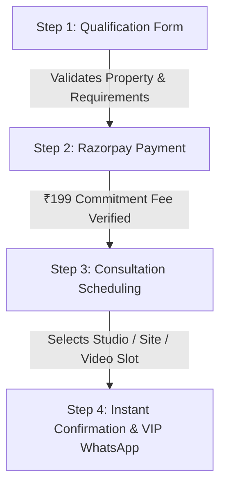
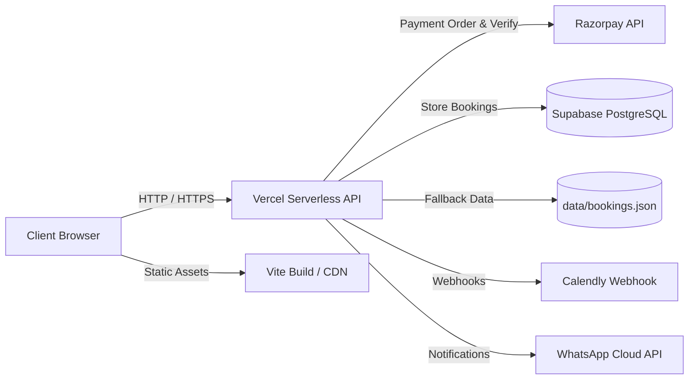

# ZR-Interior-Landing-page — ZR Interior Design High-Conversion Funnel

<div align="center">


# 🏛️ ZR Interior Design — Architectural & Turnkey Funnel
**Bespoke Luxury Interior Architecture & Turnkey Execution**  
*Serving Vadodara, Gujarat & Across India | Established Legacy 1990–2026*  
**Principal Designer: Mr. Zuber Rafik Banzara**

[](https://vitejs.dev/)
[](https://nodejs.org/)
[](https://vercel.com/)
[](https://supabase.com/)
[](https://razorpay.com/)
[](https://calendly.com/)
[](https://business.whatsapp.com/)

[**Explore Live Project**](https://zr-interior-landing-page.vercel.app/) • [**Book 45-Min Consultation**](#-4-step-consultation-funnel) • [**API Reference**](#-api-specification) • [**Setup Guide**](#-installation--local-setup)

</div>

---

## 📑 Table of Contents

1. [Project Overview](#-project-overview)
2. [Heritage & Brand Identity](#-heritage--brand-identity)
3. [Design System & Aesthetics](#-design-system--aesthetics)
4. [Key Features & User Journey](#-key-features--user-journey)
5. [The 4-Step Conversion Funnel](#-the-4-step-conversion-funnel)
6. [System Architecture](#-system-architecture)
7. [Tech Stack](#-tech-stack)
8. [Directory & File Structure](#-directory--file-structure)
9. [API Specification & Endpoints](#-api-specification)
10. [Database Schema (Supabase / PostgreSQL)](#-database-schema)
11. [Environment Configuration](#-environment-configuration)
12. [Installation & Local Setup](#-installation--local-setup)
13. [Vercel Deployment & Production Guide](#-vercel-deployment--production-guide)
14. [Security & Verification Mechanisms](#-security--verification-mechanisms)
15. [Studio & Contact Information](#-studio--contact-information)

---

## 🏛️ Project Overview

**ZR-Interior-Landing-page** is an enterprise-grade, high-conversion landing page and consultation funnel built for **ZR Interior Design**, a high-end architectural and interior design studio with over **36 years of heritage (1990–2026)** and **500+ executed luxury residences and commercial spaces**.

Engineered specifically to convert high-net-worth traffic from Meta Ads (Instagram/Facebook), architectural referrals, and organic search into committed **45-minute architectural consultations**, the application combines:
- An **editorial architectural aesthetic** with bespoke typography and tailored warm neutral tones.
- An **interactive 1990–2026 heritage milestone timeline**.
- A **curated portfolio gallery** with dynamic category filtering and modal design briefs.
- A **real-time luxury cost and budget estimator**.
- A **secure 4-step consultation booking funnel** enforcing a ₹199 commitment fee (100% adjustable against project value) via **Razorpay**, automated scheduling via **Calendly**, and instant VIP dispatch via **WhatsApp**.

---

## 🎖️ Heritage & Brand Identity

### The Legacy of Mr. Zuber Rafik Banzara
- **Founded**: 1990 (Originated as a specialized wood-crafting & artisanal joinery workshop).
- **Heritage**: 36 continuous years of architectural design and turnkey craftsmanship (1990–2026).
- **Projects Completed**: Over 500+ luxury apartments, duplexes, penthouses, bespoke villas, salons, and corporate offices.
- **Credentials & Accreditations**:
  - London School of Trends Upgradation.
  - Associated with the Institute of Indian Interior Designers (IIID).
  - Cross-border design and execution experience spanning **India, USA, UAE, and the UK**.
  - Complete turnkey site governance and execution mastery.

---

## 🎨 Design System & Aesthetics

The application adheres to an editorial, warm-limestone luxury design system crafted via custom CSS variables without heavy UI frameworks:

### Color Palette (Custom Design Tokens)
| Token Name | Hex Code | HSL / RGB | Usage |
| :--- | :--- | :--- | :--- |
| `--color-limestone-light` | `#FAF8F5` | `hsl(36, 33%, 97%)` | Primary background, clean spacious canvas |
| `--color-limestone` | `#F2EEE7` | `hsl(38, 25%, 93%)` | Secondary surfaces, section panels, cards |
| `--color-limestone-dark` | `#E5DFD3` | `hsl(39, 24%, 86%)` | Borders, subtle dividers, structural lines |
| `--color-charcoal-deep` | `#141312` | `hsl(30, 6%, 7%)` | High-contrast luxury text, dark mode backings |
| `--color-charcoal-muted`| `#4A4744` | `hsl(30, 4%, 28%)` | Body copy, secondary descriptions |
| `--color-bronze-warm` | `#8E6D3A` | `hsl(37, 42%, 39%)` | Primary architectural accent, focus states |
| `--color-bronze-light` | `#C4A777` | `hsl(37, 42%, 62%)` | Badges, subtle highlights, glowing borders |
| `--color-bronze-dark` | `#5C4420` | `hsl(37, 48%, 24%)` | Hover active buttons, deep bronze accents |

### Typography Hierarchy
- **Display Headings**: `Cinzel`, `Playfair Display`, `Cormorant Garamond` (Serif elegance reflecting heritage architecture).
- **Body & Controls**: `Inter`, `Outfit`, `system-ui` (Legibility, precision metrics, and clean readability).

---

## ✨ Key Features & User Journey

1. **Architectural Hero Section**:
   - Compelling value proposition targeted at luxury property owners.
   - Prominent portrait of Principal Designer **Mr. Zuber Rafik Banzara** enclosed in an architectural passe-partout matting frame.
   - Dual-action CTAs: Direct 4-step Consultation Funnel and Portfolio exploration.
   - Trust badge bar highlighting: *36 Years Heritage*, *500+ Projects*, *45-Day Handover Protocol*, *₹199 Adjustable Discovery Fee*.

2. **Milestone Heritage Timeline (1990–2026)**:
   - Interactive chronological progression showcasing the evolution of ZR Interior Design from a 1990 joinery studio to a 2026 nationwide turnkey design practice.

3. **Interactive Curated Portfolio**:
   - Filterable tabs: `All`, `Living Room`, `Modular Kitchen`, `Master Suite`, `Commercial Spaces`.
   - High-definition photography with lazy loading and responsive WebP image optimization.
   - Modal inspection providing architectural specifications, carpet area, materials used, and concept notes.

4. **Dynamic Cost & Budget Estimator**:
   - Live interactive calculator estimating turnkey project investment based on:
     - **Property Configuration**: 2BHK, 3BHK, 4BHK / Penthouse, Luxury Villa, Commercial Office.
     - **Carpet Area Slider**: 800 sq ft to 10,000+ sq ft.
     - **Finish Tier**: *Essential Luxury*, *Premium Architectural*, *Bespoke Ultra-Luxury Turnkey*.
   - Instant calculation of estimated budget, timeline (weeks), and one-click transfer into the qualification booking form.

5. **3-Phase Execution Methodology**:
   - *Phase 1 — Spatial Concept & 3D Architectural Photorealism*
   - *Phase 2 — Material Procurement, Joinery & Millwork Engineering*
   - *Phase 3 — Turnkey Site Execution, White-Glove Staging & Handover*

6. **Principal Designer Credentials & Philosophy**:
   - Comprehensive biography of Mr. Zuber Rafik Banzara detailing design philosophy, global exposure, and turnkey craftsmanship.

7. **Verified Client Testimonials & Social Proof**:
   - High-profile client reviews from premium residential and commercial projects in Vadodara and across Gujarat.

8. **Persistent Floating VIP Concierge**:
   - Pulse-animated WhatsApp floating action button opening direct conversations with the studio design desk at `+91 7878588859`.

---

## ⚡ The 4-Step Conversion Funnel

The core conversion engine is a frictionless 4-step modal flow designed to filter serious clients while maintaining high conversion rates:



### Step 1: Project Qualification
Intakes client details and project parameters:
- Full Name, Phone / WhatsApp (+91 validation), Email.
- Property Type: *3BHK, 4BHK, Penthouse, Luxury Villa, Commercial Space*.
- Project Location: *Vadodara (Alkapuri, Vasna-Bhayli, Sevasi, Sunpharma Road, Gotri, etc.) or Outstation*.
- Budget Range: *₹10–15L, ₹15–25L, ₹25–50L, ₹50L–1Cr, ₹1Cr+*.
- Possession Timeline: *Ready Possession, 1–3 Months, Under Construction*.

### Step 2: Razorpay Commitment Checkout
- Collects an intentional **₹199 discovery consultation fee**.
- Prevents casual no-shows and ensures high commitment from clients.
- Fully transparent policy: **100% of the ₹199 fee is adjusted against the project quotation**.
- Handled securely with server-enforced amount (`19900` paise) and HMAC SHA-256 cryptographic verification.

### Step 3: Schedule Selection
Offers 3 convenient consultation modes:
1. **ZR Design Studio (Vadodara)** — 304 Raama Crest, Sunpharma Road (Includes tactile material palette review).
2. **On-Site Property Evaluation (Vadodara)** — Direct walkthrough at client's villa, apartment, or plot.
3. **Private Video Call (Google Meet)** — HD screen-sharing and floor plan review.
- Automated scheduling integration via **Calendly 45-Min Event** with built-in fallback slot picker.

### Step 4: Instant VIP Confirmation & Dispatch
- Generates a unique tracking reference (e.g. `ZR-BK-892104-X9KL2`).
- Provides one-click **Google Calendar** and **Apple iCal (.ics)** download.
- Pre-populates an instant **VIP WhatsApp Dispatch Link** pre-filled with the client's name, reference ID, property type, and confirmed appointment slot.
- Dispatches automated background notifications via Meta Cloud WhatsApp API if configured.

---

## 📐 System Architecture

The application is engineered with a hybrid architecture supporting both **Vercel Serverless Edge** deployment and a standalone **Node.js Express / HTTP** service.



---

## 🛠️ Tech Stack

| Layer | Technology | Description |
| :--- | :--- | :--- |
| **Frontend Framework** | Vanilla JavaScript (ES6+ Modules) | Lightweight, zero-dependency, ultra-fast DOM execution |
| **Markup & Semantics** | Semantic HTML5 | Accessible, SEO-optimized tags and OpenGraph schema |
| **Styling & Design** | Vanilla CSS3 (Custom Properties) | Modular design tokens (`variables.css`, `base.css`, `components.css`) |
| **Build & Bundler** | [Vite 5](https://vitejs.dev/) | Sub-second HMR, tree-shaking, and minified production bundles |
| **Serverless Runtime** | Vercel Serverless Functions | Serverless Node.js endpoints in `/api` |
| **Local / Standalone Server** | Node.js HTTP / Express (`server/`) | Self-hosted server with API routing & static serving |
| **Database** | [Supabase](https://supabase.com/) (PostgreSQL) | Managed cloud PostgreSQL with RLS, triggers, and indices |
| **Local Storage Fallback**| JSON File System (`data/`) | Zero-config automatic local file persistence for development |
| **Payment Gateway** | [Razorpay](https://razorpay.com/) SDK | Server-enforced orders, checkout modal, HMAC verification |
| **Scheduling Engine** | [Calendly](https://calendly.com/) | 45-minute event embed, webhooks, and calendar dispatch |
| **Messaging & CRM** | WhatsApp Cloud API & Click-to-Chat | Automated confirmation messages and instant WhatsApp link |
| **Tracking & Analytics** | Meta Pixel & Conversions API | Custom events: `Lead`, `InitiateCheckout`, `Purchase` |

---

## 📁 Directory & File Structure

```
ZR-Interior-Landing-page/
├── api/                                # Vercel Serverless Function Endpoints
│   ├── booking/
│   │   └── [id].js                     # GET /api/booking/:id — Fetch booking by reference
│   ├── calendly/
│   │   └── webhook.js                  # POST /api/calendly/webhook — Handles invitee.created
│   ├── razorpay/
│   │   ├── create-order.js             # POST /api/razorpay/create-order — Server-side order generation
│   │   ├── verify-payment.js           # POST /api/razorpay/verify-payment — Cryptographic HMAC verification
│   │   └── webhook.js                  # POST /api/razorpay/webhook — Razorpay server webhook handler
│   ├── confirm-appointment.js          # POST /api/confirm-appointment — Updates confirmed appointment slot
│   └── status.js                       # GET /api/status — Diagnostics & gateway readiness check
├── assets/                             # Static visual assets
│   ├── icons/                          # SVG icons and visual glyphs
│   └── images/
│       ├── FinalImages/                # Curated architectural renderings, moodboards & project photos
│       │   ├── Architectural Bedroom Plan and Render Comparison.png
│       │   ├── From Plan to Luxury Kitchen.png
│       │   ├── Interior Design Moodboard Collection.png
│       │   ├── Sketch to Reality_ Modern Living Room.png
│       │   ├── Timeline.png
│       │   ├── project-apartment.jpg
│       │   └── project-penthouse.jpg
│       ├── zuber Final Photo.png       # High-resolution portrait of Mr. Zuber Rafik Banzara
│       ├── zuber-final-photo.webp      # Optimized high-speed WebP hero portrait
│       └── ...
├── data/                               # Local persistent storage directory
│   ├── .gitkeep                        # Git placeholder keeping folder tracked
│   └── bookings.json                   # Local development fallback storage (gitignored)
├── dist/                               # Production build output (generated by `npm run build`)
├── server/                             # Standalone Node.js server
│   ├── api.js                          # Unified API router for local development server
│   ├── db.js                           # Dual database layer: Supabase PostgreSQL + Local JSON fallback
│   ├── server.js                       # HTTP server hosting frontend and API on PORT 3000
│   ├── store.js                        # In-memory and disk lead state store
│   └── whatsappService.js              # Meta Cloud API WhatsApp template message dispatcher
├── src/
│   ├── components/
│   │   └── ConsultationBooking.jsx     # Optional React component implementation of the funnel
│   ├── js/
│   │   ├── booking.js                  # 4-Step modal consultation booking funnel engine
│   │   ├── calculator.js               # Real-time project cost and budget estimator
│   │   ├── config.js                   # Central business configuration, studio credentials & URLs
│   │   ├── form.js                     # Step 1 lead qualification form validator
│   │   ├── gallery.js                  # Portfolio category filter and lightbox viewer
│   │   ├── main.js                     # Global event initialization, smooth scroll, sticky nav
│   │   ├── payment.js                  # Razorpay checkout modal controller
│   │   ├── tracking.js                 # Meta Pixel and event dispatchers
│   │   └── whatsapp.js                 # WhatsApp VIP link builder and notification helpers
│   └── styles/
│       ├── base.css                    # CSS resets, typography standards, global layouts
│       ├── components.css              # Cards, hero matting, buttons, modals, badges, estimators
│       └── variables.css               # Design tokens, color system, spacing, elevations
├── supabase/
│   └── schema.sql                      # Complete PostgreSQL schema for consultation_bookings
├── .env.example                        # Documented environment variable template
├── .gitignore                          # Exclusions: .env, node_modules, dist, data/*.json
├── index.html                          # Main high-conversion landing page HTML5 markup
├── package.json                        # Project metadata, scripts, and dependencies
├── vercel.json                         # Vercel deployment routing, serverless rewrites, and asset caching
└── vite.config.js                      # Vite bundler configuration with API dev server proxy
```

---

## 📡 API Specification

All endpoints support CORS, return standard JSON, and are available under `/api/*`.

### 1. Diagnostic Status
- **Endpoint**: `GET /api/status`
- **Purpose**: System health check; reveals whether Razorpay, Supabase, and Calendly are configured.
- **Sample Response**:
  ```json
  {
    "status": "healthy",
    "timestamp": "2026-10-11T10:45:00.000Z",
    "environment": "development",
    "integrations": {
      "razorpay": { "configured": true, "keyId": "rzp_test_suite_key_123" },
      "supabase": { "configured": true },
      "calendly": { "configured": true }
    }
  }
  ```

### 2. Create Razorpay Order
- **Endpoint**: `POST /api/razorpay/create-order`
- **Payload**:
  ```json
  {
    "leadData": {
      "name": "Arjun Patel",
      "phone": "+91 98765 43210",
      "email": "arjun.patel@example.com",
      "location": "Vasna-Bhayli, Vadodara",
      "propertyType": "4BHK Luxury Villa",
      "budgetTier": "25-50Lacs",
      "stage": "Possession received"
    }
  }
  ```
- **Success Response (`200 OK`)**:
  ```json
  {
    "orderId": "order_NX8aBc12DeFgHi",
    "amount": 19900,
    "currency": "INR",
    "keyId": "rzp_live_xxxxxxxxxxxx",
    "bookingRef": "ZR-BK-892104-X9KL2"
  }
  ```

### 3. Verify Payment
- **Endpoint**: `POST /api/razorpay/verify-payment`
- **Payload**:
  ```json
  {
    "razorpay_order_id": "order_NX8aBc12DeFgHi",
    "razorpay_payment_id": "pay_NX8b98KlMnOpQr",
    "razorpay_signature": "5d2b7e9...",
    "bookingRef": "ZR-BK-892104-X9KL2"
  }
  ```
- **Success Response (`200 OK`)**:
  ```json
  {
    "success": true,
    "message": "Payment verified successfully",
    "bookingRef": "ZR-BK-892104-X9KL2",
    "calendlyUrl": "https://calendly.com/zrinteriordesign/30min?name=Arjun%20Patel&email=arjun.patel%40example.com"
  }
  ```

### 4. Confirm Appointment
- **Endpoint**: `POST /api/confirm-appointment`
- **Payload**:
  ```json
  {
    "bookingRef": "ZR-BK-892104-X9KL2",
    "date": "2026-10-18",
    "timeSlot": "04:30 PM",
    "mode": "studio"
  }
  ```
- **Success Response (`200 OK`)**:
  ```json
  {
    "success": true,
    "booking": {
      "bookingRef": "ZR-BK-892104-X9KL2",
      "appointmentDate": "2026-10-18",
      "appointmentTime": "04:30 PM",
      "appointmentStatus": "SCHEDULED"
    }
  }
  ```

### 5. Fetch Booking by Reference
- **Endpoint**: `GET /api/booking/:id`
- **Response (`200 OK`)**: Returns complete customer qualification, payment status, and appointment details.

### 6. Webhooks
- **Razorpay Webhook**: `POST /api/razorpay/webhook` — Listens for `payment.captured` or `payment.failed`, verifies `X-Razorpay-Signature`, and updates booking records.
- **Calendly Webhook**: `POST /api/calendly/webhook` — Listens for `invitee.created` and automatically marks the consultation appointment as `SCHEDULED`.

---

## 🗄️ Database Schema

The system uses **Supabase PostgreSQL** as its primary persistent store, configured via `supabase/schema.sql`:

```sql
CREATE TABLE IF NOT EXISTS consultation_bookings (
  id UUID PRIMARY KEY DEFAULT gen_random_uuid(),
  booking_reference VARCHAR(64) UNIQUE NOT NULL,
  
  -- Customer Qualification
  customer_name VARCHAR(255) NOT NULL,
  customer_email VARCHAR(255),
  customer_phone VARCHAR(50) NOT NULL,
  customer_phone_raw VARCHAR(50),
  project_location VARCHAR(255),
  property_type VARCHAR(100),
  budget_tier VARCHAR(100),
  project_stage VARCHAR(100),
  project_description TEXT,
  
  -- Payment Tracking (Enforced ₹199 = 19900 paise)
  consultation_fee_paise INTEGER NOT NULL DEFAULT 19900,
  currency VARCHAR(10) NOT NULL DEFAULT 'INR',
  razorpay_order_id VARCHAR(100) UNIQUE,
  razorpay_payment_id VARCHAR(100) UNIQUE,
  razorpay_signature TEXT,
  payment_status VARCHAR(50) NOT NULL DEFAULT 'PENDING',
  payment_verified_at TIMESTAMPTZ,
  payment_metadata JSONB DEFAULT '{}'::jsonb,
  
  -- Scheduling Details
  calendly_event_uri TEXT,
  calendly_invitee_uri TEXT,
  appointment_date VARCHAR(100),
  appointment_time VARCHAR(100),
  timezone VARCHAR(100) DEFAULT 'Asia/Kolkata',
  appointment_status VARCHAR(50) NOT NULL DEFAULT 'UNSCHEDULED',
  appointment_confirmed_at TIMESTAMPTZ,
  
  -- Communication Tracking
  whatsapp_followup_status VARCHAR(50) DEFAULT 'PENDING',
  whatsapp_last_interaction_at TIMESTAMPTZ,
  
  -- Timestamps
  created_at TIMESTAMPTZ NOT NULL DEFAULT NOW(),
  updated_at TIMESTAMPTZ NOT NULL DEFAULT NOW()
);
```

> **Automatic Fallback**: If Supabase credentials are not provided during local development, `server/db.js` automatically routes writes to `data/bookings.json` with an in-memory serverless cache.

---

## 🔐 Environment Configuration

Create a `.env` file in the project root by copying `.env.example`:

```bash
cp .env.example .env
```

| Variable Name | Required | Default / Example | Purpose |
| :--- | :---: | :--- | :--- |
| `PORT` | Optional | `3000` | Port for the local Node.js development server |
| `NODE_ENV` | Optional | `development` | Set to `production` when deployed |
| `APP_BASE_URL` | Yes (Prod) | `https://zr-interior-landing-page.vercel.app` | Canonical domain for URLs and webhooks |
| `RAZORPAY_KEY_ID` | Yes | `rzp_test_...` / `rzp_live_...` | Razorpay API Key ID from Dashboard |
| `RAZORPAY_KEY_SECRET` | Yes | `xxxxxxxxxxxxxxxx` | Razorpay Key Secret |
| `RAZORPAY_WEBHOOK_SECRET` | Optional | `xxxxxxxxxxxxxxxx` | Secret configured in Razorpay Webhooks |
| `CONSULTATION_AMOUNT_PAISE`| Optional | `19900` | Consultation fee in paise (₹199 INR) |
| `CALENDLY_URL` | Optional | `https://calendly.com/zrinteriordesign/45min` | Calendly 45-min event type link |
| `CALENDLY_WEBHOOK_SIGNING_KEY` | Optional | `xxxxxxxxxxxxxxxx` | Calendly Webhook verification key |
| `WHATSAPP_BUSINESS_PHONE` | Optional | `917878588859` | Direct WhatsApp reception phone number |
| `WHATSAPP_PHONE_NUMBER_ID`| Optional | `1029384756` | Meta Cloud API Phone Number ID |
| `WHATSAPP_ACCESS_TOKEN` | Optional | `EAAxxxxxxxx` | Meta Cloud API System User Access Token |
| `SUPABASE_URL` | Recommended| `https://xyz.supabase.co` | Supabase Project URL |
| `SUPABASE_SERVICE_ROLE_KEY`| Recommended| `eyJhbGci...` | Supabase Service Role Secret Key |
| `META_PIXEL_ID` | Optional | `xxxxxxxxxxxx` | Meta Ads Pixel ID for event tracking |

---

## 💻 Installation & Local Setup

### Prerequisites
- **Node.js** v18.0.0 or higher
- **npm** (v9+) or **yarn**

### Quick Start

1. **Clone the repository**:
   ```bash
   git clone https://github.com/JunedBanzara/ZR-Interior-Landing-page.git
   cd ZR-Interior-Landing-page
   ```

2. **Install project dependencies**:
   ```bash
   npm install
   ```

3. **Configure environment settings**:
   ```bash
   cp .env.example .env
   ```

4. **Start the local Vite development server**:
   ```bash
   npm run dev
   ```
   Open [http://localhost:5173](http://localhost:5173) in your browser.

5. **Start the local backend API server (Optional for full backend simulation)**:
   ```bash
   node server/server.js
   ```
   Backend listens at [http://localhost:3000](http://localhost:3000).

6. **Build for production**:
   ```bash
   npm run build
   ```

---

## 🚀 Vercel Deployment & Production Guide

The repository is pre-configured for **Zero-Config Vercel Deployment**:

1. Push your repository to GitHub: `https://github.com/JunedBanzara/ZR-Interior-Landing-page`.
2. Go to [Vercel](https://vercel.com) and click **"Add New Project"**.
3. Import the `ZR-Interior-Landing-page` repository.
4. Framework Preset will automatically detect **Vite**.
5. Add the Environment Variables from your `.env` in **Project Settings > Environment Variables**:
   - `RAZORPAY_KEY_ID` (Live key: `rzp_live_...`)
   - `RAZORPAY_KEY_SECRET`
   - `SUPABASE_URL`
   - `SUPABASE_SERVICE_ROLE_KEY`
   - `APP_BASE_URL`
6. Click **Deploy**. Vercel will build the frontend assets and automatically serve the API endpoints under `/api/*`.

---

## 🛡️ Security & Verification Mechanisms

1. **Server-Enforced Pricing**:
   The fee is hardcoded on the server (`19900` paise). Frontend parameter tampering cannot alter the transaction charge.
2. **Cryptographic HMAC-SHA256 Signature Verification**:
   Razorpay signatures are verified on the server using Node.js `crypto` with `RAZORPAY_KEY_SECRET`:
   ```javascript
   const generatedSignature = crypto
     .createHmac('sha256', process.env.RAZORPAY_KEY_SECRET)
     .update(`${orderId}|${paymentId}`)
     .digest('hex');
   ```
3. **Database Row Level Security (RLS)**:
   Supabase tables are protected by RLS policies; public client connections cannot query private client consultation records.
4. **Environment Isolation**:
   Secrets, tokens, and private database keys are strictly isolated to serverless execution environments and excluded from version control via `.gitignore`.

---

## 📍 Studio & Contact Information

| Parameter | Details |
| :--- | :--- |
| **Studio Name** | **ZR Interior Design** |
| **Principal Designer** | **Mr. Zuber Rafik Banzara** |
| **Studio Address** | 304, Raama Crest, Near HCG Cancer Center, Sunpharma Road, Vadodara, Gujarat 390012, India |
| **Phone Desk** | [+91 7878588859](tel:+917878588859) |
| **WhatsApp Direct** | [+91 7878588859](https://wa.me/917878588859) |
| **Official Email** | [zrinteriordesign@gmail.com](mailto:zrinteriordesign@gmail.com) |
| **Hours of Operation** | Monday – Saturday: 10:00 AM – 7:30 PM IST (Consultations by Appointment) |

---

<div align="center">

**Proprietary © 1990–2026 ZR Interior Design.**  
*Handcrafted with precision for luxury architectural excellence.*

</div>
